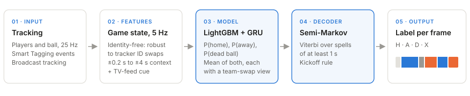
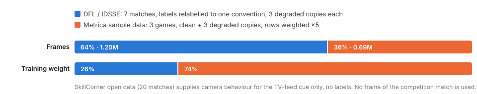

<p align="center">
  <picture>
    <source media="(prefers-color-scheme: dark)" srcset="assets/banner-dark.png">
    
  </picture>
</p>

<h1 align="center">Garuda</h1>

<p align="center">
  Frame-level ball possession from football tracking data.<br>
  Team Garuda · More than a Hack 2027, Phase 1
</p>

<p align="center">
  
  
  
  <a href="LICENSE"></a>
</p>

For every frame of the match video, Garuda says who has the ball: **H** (home), **A** (away),
**D** (dead ball) or **X** (not scored). It reads the provided automatic tracking, Smart Tagging
and broadcast tracking, runs on a laptop CPU in under a minute, and regenerates the submitted file
byte for byte.

## How it works

<p align="center"></p>

- **Features.** Game-state descriptors at 5 Hz that never rely on player identity, so tracker ID
  swaps and fragments do no harm: who is near the ball, team shape and speed, ball visibility and
  gaps, over context windows from ±0.2 s to ±4 s. A TV-feed cue adds whether the broadcast is
  showing live play.
- **Model.** One LightGBM classifier gives home, away and dead-ball probabilities, averaged with a
  team-swapped view of the same frame.
- **Decoder.** A semi-Markov Viterbi turns probabilities into possession spells of at least one
  second, so the output does not flicker. A kickoff rule marks the time before kickoff as dead.

## Training data

Only open data from other matches. No frame of the competition match is used to train, tune or
validate.

<p align="center"></p>

| Source | Use | Licence |
|---|---|---|
| [DFL / IDSSE](https://doi.org/10.6084/m9.figshare.28196177) (Bassek et al., 2025) | 7 matches; possession relabelled to one convention; broadcast-like degradation simulated | CC BY 4.0 |
| [Metrica Sports sample data](https://github.com/metrica-sports/sample-data) | 3 games; possession from the event logs; rows weighted ×5 | no licence file; credit requested |
| [SkillCorner open data](https://github.com/SkillCorner/opendata) | camera behaviour for the TV-feed cue; no labels | MIT |

## Quick start

macOS or Linux (Windows: WSL). Python 3.11.

```bash
git clone https://github.com/aryawidjaja/garuda-mtah2027.git
cd garuda-mtah2027
./setup.sh                                   # creates .venv with pinned dependencies
```

The match data is licensed to enrolled participants and is **not** in this repository. Put your
copy of `Initial_Challenge-Dataset/` in the repository folder (it is git-ignored). Prediction needs:

```
Initial_Challenge-Dataset/
├─ tactical/   BAR-ATH_tactical_atd.txt, BAR-ATH_tactical_atd.xml, BAR-ATH_tactical_smart_tagging.xml
└─ broadcast/  BAR-ATH_broadcast_atd.txt, BAR-ATH_broadcast_atd.xml, BAR-ATH_broadcast_homography.csv
```

Then:

```bash
export MTAH_DATA_DIR=$PWD/Initial_Challenge-Dataset
.venv/bin/python garuda/scripts/predict.py --out outputs/Garuda.csv     # prints the path and VALID
./verify_reproduction.sh /path/to/Garuda.csv                            # prints SAME or DIFFERENT
```

Without the Smart Tagging or broadcast files the pipeline still runs, but the kickoff rule or the
TV-feed cue switches off and the output differs from the submission.

## Retrain

Retraining needs the three open datasets in `external/raw/` (git-ignored):

| Folder | Source |
|---|---|
| `idsse/` | the 21 `DFL_02_01`, `DFL_03_02`, `DFL_04_03` XML files from [figshare 28196177](https://doi.org/10.6084/m9.figshare.28196177) |
| `metrica/` | `git clone https://github.com/metrica-sports/sample-data` (commit `e706dd5`) |
| `skillcorner/` | `GIT_LFS_SKIP_SMUDGE=1 git clone https://github.com/SkillCorner/opendata` (commit `4340d27`) |
| `skillcorner_lfs/` | the 20 `<id>_tracking_extrapolated.jsonl` LFS files of that repository |

```bash
.venv/bin/python garuda/scripts/build_external.py    # external/raw -> external/processed
.venv/bin/python garuda/scripts/train_final.py       # writes garuda/model/
```

Training is CPU-only and not bit-reproducible; inference is.

## Repository layout

```
garuda/garuda/    data readers, features, degradation simulator, relabelling, decoder
garuda/scripts/   predict.py, train_final.py, build_external.py and the training helpers
garuda/model/     the submitted model (LightGBM weights + decoder config)
official-repo/    the organisers' games.py and possession_metrics.py (MIT), used by predict.py
```

## Licence

Code: [MIT](LICENSE). `official-repo/`: the organisers' files, MIT. Open datasets under their own
licences, listed above.
