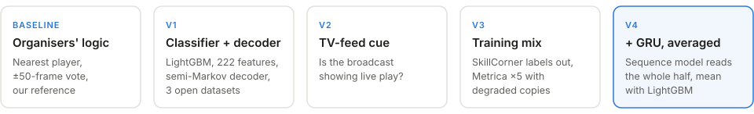

<p align="center">
  <picture>
    <source media="(prefers-color-scheme: dark)" srcset="assets/banner-dark.png">
    
  </picture>
</p>

<p align="center">
  Team Garuda · More than a Hack 2027, Phase 1: Ball Possession
</p>

<p align="center">
  
  
  
  
  <a href="LICENSE"></a>
</p>

For every frame of the match video, Garuda says who has the ball: **H** (home), **A** (away),
**D** (dead ball) or **X** (not scored). It reads the provided automatic tracking, Smart Tagging
and broadcast tracking, runs on a laptop CPU in under a minute, and regenerates the submitted file
byte for byte.

## Team

| Member |
|---|
| Patrisius Bagus Alvito Baylon |
| Budiman Apri Utomo |
| Anthony Nathan Sinisuka |
| Mutaqin Aryawijaya |

## Validation

Everything is validated on **other, open matches**, with the official scorer: DFL matches with
tracking degraded to look like the competition's, Metrica games both clean and degraded, and two
DFL matches locked away from all development. On these tests the submitted model scores roughly
**0.6 to 0.75 `spellF1`**, depending on the test. None of this is a score on the competition match,
which only the organisers can grade. The 5 public minutes were used only to check the file format
and frame alignment.

Every number can be regenerated from this repository: see
[Retrain and rerun the experiments](#retrain-and-rerun-the-experiments).

## How it works

<p align="center"></p>

- **Features.** Game-state descriptors at 5 Hz that never rely on player identity, so tracker ID
  swaps and fragments do no harm: who is near the ball, team shape and speed, ball visibility and
  gaps, over context windows from ±0.2 s to ±4 s. A TV-feed cue adds whether the broadcast is
  showing live play.
- **Model.** A LightGBM classifier and a small bidirectional GRU each give home, away and dead-ball
  probabilities, each averaged with a team-swapped view. LightGBM reads one moment and its context
  windows; the GRU reads the whole half as one sequence. The submission uses the mean of the two.
- **Decoder.** A semi-Markov Viterbi turns probabilities into possession spells of at least one
  second, so the output does not flicker. A kickoff rule marks the time before kickoff as dead.

## How we built it

<p align="center"></p>

| Version | What changed | Why |
|---|---|---|
| v1 | LightGBM on 222 identity-free features, semi-Markov decoder, trained on DFL, SkillCorner and Metrica | The decoder gave the largest single gain: `spellF1` punishes flicker more than per-frame errors |
| v2 | TV-feed cue: is the broadcast showing live play? | Won 8 of 10 paired comparisons and helped dead-ball detection on all 5 DFL matches |
| v3 | SkillCorner labels dropped; Metrica added as degraded copies and weighted ×5 | SkillCorner's possession changes hands twice as often as Metrica's, so its labels pulled the model away from the target convention |
| v4 | A small bidirectional GRU, averaged with LightGBM | The two models make different mistakes; the average beat v3 on 3 of 3 Metrica games, 4 of 5 DFL matches and both locked matches |

**How we worked**

1. **No labels from the competition match.** Every model learns from open matches with their own
   labels, and every setting is chosen on those matches.
2. **Make the training data look like the test.** A simulator corrupts clean tracking the way
   single-camera tracking fails: ball gaps where players crowd it, aerial balls, lost players and
   noise, three random draws per match.
3. **Fix the rule before the result.** Each idea is compared with the same system without it, on
   the same held-out matches. The bar for adopting it is written down before the run.
4. **A locked test, used sparingly.** Two DFL matches stayed out of all development. Each
   candidate version was scored on them once.
5. **Reproduce exactly.** Inference is deterministic. Running the repository on the data gives
   the submitted file byte for byte, and `verify_reproduction.sh` checks it.

**Tried and dropped.** Each idea was compared on the same held-out matches against the system
without it:

| Idea | Result |
|---|---|
| Spell-aware path selection (minimum Bayes risk) | within noise, 2 of 5 matches up |
| Smart Tagging set-piece evidence in the decoder | within noise |
| Decoder state for the restarting team | slightly worse |
| Switch cost tied to take-over probability | small gain at one setting, not consistent |
| More features: control history, ball heading, ±10 s and ±30 s windows | worse on 4 of 5 matches |
| Line-of-sight features for aerial balls | worse on average, 2 of 5 matches up |
| Longer minimum stoppage (2, 3, 5 s) | slightly worse at every length |
| Hand-edited GRU weights (memory and output units, no retraining), two independent attempts | no change on held-out matches |
| Training rows near possession changes weighted ×40, from another team's published write-up | worse on the first two DFL matches; stopped |

## Training data

Only open data from other matches. No frame of the competition match is used to train, tune or
validate.

<p align="center"></p>

| Source | Use | Licence |
|---|---|---|
| [DFL / IDSSE](https://doi.org/10.6084/m9.figshare.28196177) (Bassek et al., 2025) | 7 matches; possession relabelled to one convention; broadcast-like degradation simulated | CC BY 4.0 |
| [Metrica Sports sample data](https://github.com/metrica-sports/sample-data) | 3 games; possession from the event logs; rows weighted ×5 | no licence file; credit requested |
| [SkillCorner open data](https://github.com/SkillCorner/opendata) | camera behaviour for the TV-feed cue; no labels | MIT |

## Quick start

macOS or Linux (Windows: WSL). Python 3.11.

```bash
git clone https://github.com/aryawidjaja/garuda-mtah2027.git
cd garuda-mtah2027
./setup.sh                                   # creates .venv with pinned dependencies
```

The match data is licensed to enrolled participants and is **not** in this repository. Put your
copy of `Initial_Challenge-Dataset/` in the repository folder (it is git-ignored). Prediction needs:

```
Initial_Challenge-Dataset/
├─ tactical/   BAR-ATH_tactical_atd.txt, BAR-ATH_tactical_atd.xml, BAR-ATH_tactical_smart_tagging.xml
└─ broadcast/  BAR-ATH_broadcast_atd.txt, BAR-ATH_broadcast_atd.xml, BAR-ATH_broadcast_homography.csv
```

Then:

```bash
export MTAH_DATA_DIR=$PWD/Initial_Challenge-Dataset
.venv/bin/python garuda/scripts/predict.py --out outputs/Garuda.csv     # prints the path and VALID
./verify_reproduction.sh /path/to/Garuda.csv                            # prints SAME or DIFFERENT
```

Without the Smart Tagging or broadcast files the pipeline still runs, but the kickoff rule or the
TV-feed cue switches off and the output differs from the submission.

## Retrain and rerun the experiments

Retraining needs the three open datasets in `external/raw/` (git-ignored):

| Folder | Source |
|---|---|
| `idsse/` | the 21 `DFL_02_01`, `DFL_03_02`, `DFL_04_03` XML files from [figshare 28196177](https://doi.org/10.6084/m9.figshare.28196177) |
| `metrica/` | `git clone https://github.com/metrica-sports/sample-data` (commit `e706dd5`) |
| `skillcorner/` | `GIT_LFS_SKIP_SMUDGE=1 git clone https://github.com/SkillCorner/opendata` (commit `4340d27`) |
| `skillcorner_lfs/` | the 20 `<id>_tracking_extrapolated.jsonl` LFS files of that repository |

```bash
.venv/bin/python garuda/scripts/build_external.py    # external/raw -> external/processed
.venv/bin/python garuda/scripts/train_final.py       # writes garuda/model/
```

Training is CPU-only and not bit-reproducible; inference is.

The validation results come from scripts in `garuda/scripts/`: `final_test_blend.py` (locked pair, v3
against v4), `exp_seq.py` (development, v3 against v4), `exp_onpar.py` (clean Metrica),
`final_test.py` and `final_test_w5.py` (earlier locked-pair runs) and `experiment*.py` /
`exp_weight*.py` (v1 to v3).

## Repository layout

```
garuda/garuda/    data readers, features, degradation simulator, relabelling, GRU, decoder
garuda/scripts/   predict.py, train_final.py, build_external.py and the experiment scripts
garuda/model/     the submitted model (LightGBM and GRU weights + decoder config)
official-repo/    the organisers' games.py and possession_metrics.py (MIT), used by predict.py
```

## Licence

Code: [MIT](LICENSE). `official-repo/`: the organisers' files, MIT. Open datasets under their own
licences, listed above.
